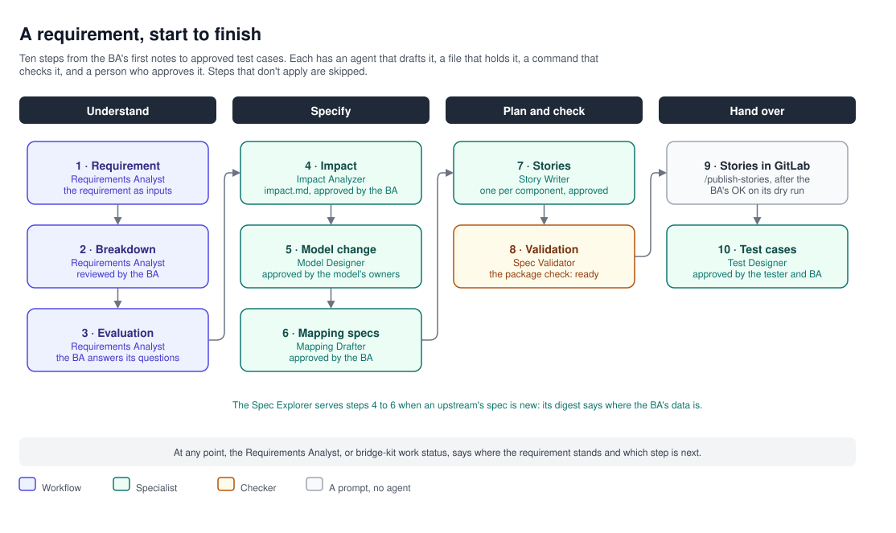
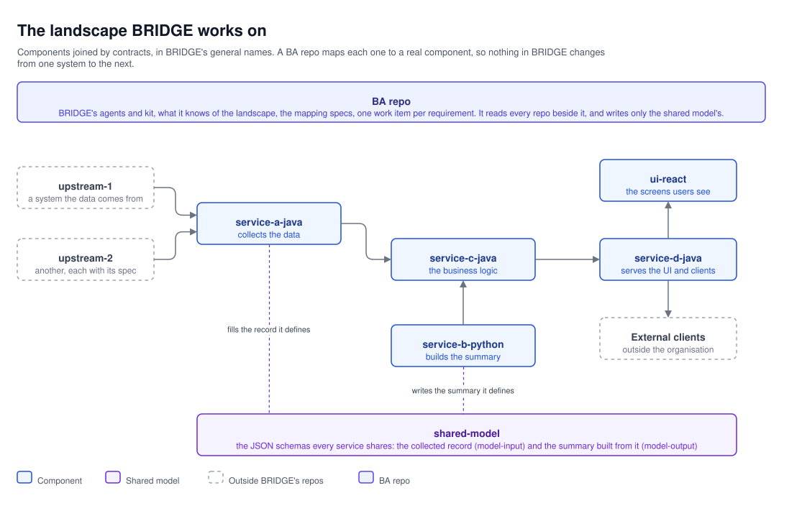

# BRIDGE design: overview

**BRIDGE: Business Requirements Intelligence & Delivery Generation Engine.** *From business ask to build-ready,
faster.*

BRIDGE is the BA's AI kit: it helps BAs turn business needs into complete, checked specs with AI agents, and keeps
every decision with people. A BA brings a requirement in business words; the agents turn it, with the BA, into a
requirement package that every affected team can build from: which components it touches and why, the change to the
shared data model, the mapping specs that fill it from the upstream systems, one story per component, and the test
cases that prove the stories. The agents run in GitHub Copilot's chat, in IntelliJ, VS Code or the Copilot CLI,
inside the BA repo.

## Where the value is

- **It goes after the expensive problem.** In a system of several services, the costly failures aren't badly worded
  stories. They're the component nobody thought a requirement touches, the field mapped wrong, and the question a
  developer comes back with weeks into the build. BRIDGE is built around those: every component accounted for, every
  field's mapping written row by row, and every package read as its developers will read it.
- **Its advantages are structural.** A general agent can't know the component catalog, the shared model's conventions
  or the existing mappings, and it can't check its output against the real specs. BRIDGE gets these from what the BA
  repo knows and what the kit checks, not from a prompt.
- **It's cheap to try.** It runs on the GitHub Copilot, GitLab and Maven repository already in use, with no new
  platform or licence. A first requirement needs a BA repo set up only for the part of the landscape it touches.
- **It's built to be trusted.** People decide, every decision is recorded, every write waits for the BA's OK, and
  the data is made up. The first questions a manager or a risk reviewer asks have their answers built in.

## What it gives

- **Complete packages.** Every requirement is followed through every component in the landscape, with the evidence
  for each one it touches and the reason for each it doesn't. Each team gets one story with the data, contracts and
  acceptance criteria it needs.
- **Checked before anyone builds.** One command checks that the package's files agree with each other before the
  developers see them, and an agent reads the package as each team's developer would and reports what they'd have to
  come back and ask.
- **Decisions on record.** Every answer is written down with who gave it. Nothing is approved while a question is
  open, and nothing leaves the BA repo without the BA's OK.
- **AI spent on judgment only.** Everything that can be worked out the same way every time is a script, and what's
  known about the landscape is written down once: see "Spending AI credits where they count", below.
- **Safe by design.** The agents read only the places the BA repo declares, use made-up data only, and never approve
  their own work.

## Why BRIDGE, not a general requirements agent

A general requirements agent, in Copilot or any other tool, writes requirements well. BRIDGE runs on the same
Copilot and adds what a general agent can't have: the system it works on, the formats its teams build from, and
checks that run as code.

| | A general requirements agent | BRIDGE |
|---|---|---|
| **Knows** | How requirements are written, in general | The system a BA works on: its component catalog and profiles, its shared model and conventions, its glossary, its existing mapping specs |
| **Produces** | Well-written prose: a story, a summary | A build-ready package in fixed formats: the impact analysis, the model change, the mapping specs, one story per component in the order the work can be done, the test cases |
| **Is checked by** | Another prompt, or nobody | Code: each file against the upstream's spec, the shared model and the catalog, and the package as a whole before the developers see it |
| **Goes as deep as** | The story | The data: where it is in an upstream's spec, each field's mapping rule, specs for code that has none, stored payloads checked against the model |
| **Remembers through** | The chat, gone with it | Files: each input with its version, each decision with who made it, each story citing the files it implements |
| **Is governed by** | Whatever the tool allows | Declared places only, a dry run before every write until the BA approves it, made-up data only, credentials no agent sees, an audit log |
| **Spends AI on** | Everything, every time | Judgment only: the checks are scripts, and the landscape is written down once |
| **Belongs to** | Its vendor | The team: plain files in the BA repo, versioned and reviewed like code, on the GitHub Copilot, GitLab and Maven repository already in use |

**In a line:** a general agent writes requirements; BRIDGE turns Copilot into a BA that knows the system, checks its
own work, and hands each team what it builds from.

## A requirement in one picture

The Requirements Analyst takes the BA through it and names the next step at any point; a specialist agent does each
step; `bridge-kit validate package` checks that the files agree before the developers see them. Not every
requirement needs every step: a wording change has no model change or mapping.

## Who does what

| Who | Does |
|---|---|
| **The BA** | Brings the requirement and what they know, answers the agents' questions, reviews every file and approves it |
| **The agents** | Read, draft, check and ask. They write only their own files, and never approve one |
| **`bridge-kit`** | The command line behind the agents: it reads specs, stories and documents, and checks every file the agents write |
| **Developers** | Take their component's story, with the package files it cites, and build from it with their own tools |
| **Testers** | Take the test cases, written from the stories' acceptance criteria |

## Every handoff a bridge

BAs and POs are the bridge between business and technology. BRIDGE carries each handoff across it the same way: an
artefact with a template, a check that it's complete, a person's approval, and agents on either side.

| Handoff | What crosses | How |
|---|---|---|
| PO → BA | The requirement: a GitLab story, emails, documents | The Requirements Analyst, `impact.md`, `validate impact` |
| BA → developer | The package: the model change, the mapping specs, one story per component | `validate package`, the BA's approval |
| BA → tester | Each story's acceptance criteria, in Given, When and Then | The Test Designer, `validate test-case`, `tests coverage` |

## Principles

- **Agents draft, people decide.** Every file an agent writes starts as a `draft`. The BA approves it by setting its
  `status`, and nothing is approved while its Open questions are open.
- **Files, not chat, are the memory.** Everything about a requirement is in its work item, `work/<id>/`: what the BA
  brought, what the agents wrote, what was decided and by whom. A new chat, or a colleague, starts from there.
- **Ask, don't guess.** What a file can't settle becomes an open question naming who answers it.
- **Checks are commands.** Every rule a file must follow is checked by a `bridge-kit` command, the same way every
  time. Skills and prompts call the commands and never repeat their logic.
- **Only declared places.** An agent reads only the checkouts, GitLab projects and services that `bridge-kit.yaml`
  declares, and writes only to the BA repo, except the Model Designer, which writes the shared model's checkout.
- **Nothing leaves without the BA's OK.** Creating a GitLab issue, pushing a branch or opening a merge request each
  waits for the BA's approval in the chat.
- **Made-up data only.** Agents describe fields and behaviour, never values from real records. Examples and test data
  are made up.
- **Everything Copilot reads lives under `.github`.** Nothing is tied to one IDE.

## Spending AI credits where they count

The model spends tokens only on judgment: what a business word means, which field fits, how a story is worded.
Everything else is written down once and read back, or done by a script.

| | BRIDGE | Instead of |
|---|---|---|
| **Know, don't discover** | The landscape is declared once: `bridge-kit.yaml`, the catalog, the profiles, the model's conventions and the glossary, written by the setup tools and read as small files on every run | Each run searching the repos for which components exist, who owns which contract, what a term means |
| | Existing code is described once, as the Reverse Engineer's mapping specs | Every requirement reading the code again |
| | `knowledge term` looks a business word up, ten matches of each kind at most | The model scanning schemas and profiles |
| **Scripts for what's deterministic** | Every check is a command: the validators, the package check, `tests coverage`, `model diff`, `work status`. They cost no tokens, and their errors name the line, so a fix is one edit | The model checking its own work by reading it again, and rewriting to fix |
| | Large inputs arrive digested: `spec digest` lists every operation and field, operations with the same fields once, and the agent searches the listing; `doc read` turns spreadsheets, documents and emails into Markdown; `payload profile` gives the shape of many payloads at once; a story comes without GitLab's system notes | The model reading a whole spec, a binary file or a pile of payloads |
| | What's converted is kept: a story or document as the work item's input, a resolved spec in `.work/specs/` | Converting the same thing on every run |
| **Small, scoped runs** | Files are the memory: a new chat starts from the work item, and `work status` works out where it stands from the files | A long chat history carried, or retold |
| | One agent, one job: each loads only the skills it needs, some only when they're needed, and reads the previous agent's file, such as `impact.md` or the spec digest | Every agent knowing everything, and redoing the analysis before it |
| | Fixed shapes: the templates and `FORMAT.md` give every file its sections and columns | Inventing a structure on every run |
| **No wasted runs** | The preflight stops a run before it reads a checkout on the wrong branch or remote | A whole run spent on the wrong code |
| | Ask, don't guess: what a file can't settle is a one-line question | A wrong guess found later, and every step after it done again |
| | One command at a time, so each command matches its approval | Refused loops, and retries |

## The landscape

BRIDGE sees the system a BA works on as components joined by contracts. This design uses general names for them; a
BA repo maps each to a real component (see [the landscape](01-landscape.md)).

| Component | Its part |
|---|---|
| `upstream-1`, `upstream-2`, … | The systems the data comes from, each described by its spec: OpenAPI, Swagger or WSDL |
| `shared-model` | The JSON schemas every service shares: the collected record, and the summary built from it |
| `service-a-java` | Calls the upstreams and fills the shared model's record from their answers, by the mapping specs |
| `service-b-python` | Builds a summary from the record. It follows the shared model and defines no schemas |
| `service-c-java` | The business logic over the record and the summary |
| `service-d-java` | The API the UI and external clients call |
| `ui-react` | The screens users see |

The BA repo sits beside them. It holds BRIDGE (`.github/`), the knowledge of the landscape (`architecture/`), the
mapping specs (`mappings/`, `lookups/`, `assembly/`), the templates, and one work item per requirement (`work/`).
Every other repo is checked out beside it and read, never written, except the shared model's.

## The running example

Every document follows one requirement, `REQ-101`: *show the customer's preferred contact channel on the customer
panel*. `upstream-1` sends the channel as a code; the shared model has no field for it yet; `service-a-java` must fill
it, `service-c-java` and `service-d-java` pass it on, and `ui-react` shows it. `service-b-python`'s summary doesn't use
it.

## The documents

| Document | Covers |
|---|---|
| **Overview** (this one) | What BRIDGE is, where its value is, what it gives, why it and not a general agent, a requirement in one picture, who does what, the handoffs it carries, its principles, how it spends AI credits, the landscape |
| [The landscape](01-landscape.md) | What each general name stands for, and how a BA repo learns the real components, model and specs |
| [A requirement, start to finish](02-requirement-flow.md) | The work item, the ten steps, approval, the package check, the hand-over |
| [The agents](03-agents.md) | How the agents work together, the rules they follow, each agent, the standalone prompts |
| [The package](04-package.md) | Each file a requirement package is made of, and what checks it |
| [The kit](05-kit.md) | `bridge-kit`, its configuration, the preflight, its connections to GitLab, specs, documents and payloads |

The diagrams are in `diagrams/`, each an SVG that draw.io opens to edit. What BRIDGE doesn't do yet is in
[`BACKLOG.md`](../BACKLOG.md).

**Names.** The name is **BRIDGE** in prose, in capitals, and **`bridge-kit`** in the code: the folder
`.github/bridge-kit/`, the command `bridge-kit`, the configuration `bridge-kit.yaml`, the MCP server
`bridge-kit-mcp`, the Python package `bridge_kit` and the environment variables `BRIDGE_KIT_*`.
