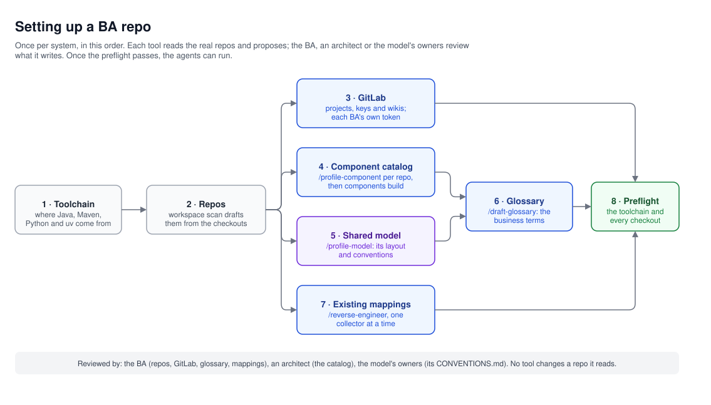

# BRIDGE design: the landscape, and how a BA repo learns it

The agents know nothing about a system until its BA repo describes it. This document says what each general name in
the design stands for, where a BA repo writes down the real components, model and specs, and how each is filled in
from the repos themselves.

## The general names

| General name | Stands for | Its real name is written in |
|---|---|---|
| `shared-model` | The repo of JSON schemas the services share | `bridge-kit.yaml` (`model.repo`), the catalog |
| `service-a-java`, `service-b-python`, `service-c-java`, `service-d-java` | The services, each in its own repo | `bridge-kit.yaml` (`workspace.repos`), the catalog |
| `ui-react` | The front end | `bridge-kit.yaml`, the catalog |
| `model-input`, `model-output`, `service-a-api`, … | The contracts between them: schemas and APIs | The catalog's `contracts` |
| `upstream-1`, `upstream-2`, … | The systems the data comes from | The mapping specs, by the upstream's id, and its spec's coordinates |
| `CustomerRecord` | The root of the record the shared model defines | The catalog's contract `root`, the assembly spec |

A BA repo replaces every general name with the real one in the files below. The agents, the templates and the checks
read those files, so nothing in BRIDGE itself changes.

## What a BA repo knows, and where

| File | Holds | Read by |
|---|---|---|
| `.github/bridge-kit/bridge-kit.yaml` | The repos and where they're checked out, their branch, remote and access; the shared model's repo, layout and conventions; GitLab's projects and wikis; the Maven repository for specs; stored payloads; the toolchain | Every command, the preflight |
| `architecture/components.yaml` | The component catalog: each component's order, repo, stack, the contracts it owns and consumes, whether it faces external clients, where its stories go | The Impact Analyzer, the Story Writer, the package check, story publishing |
| `architecture/components/<name>.md` | Each component's profile: what it does in business words, its data, contracts, screens or operations, and where changes go | The Impact Analyzer, the Story Writer, the Test Designer |
| The catalog's `knowledge:` | Pointers, by kind, to what each component's team keeps for its own AI tools in its repo: its glossary, its lineage, its anatomy, its contract rules, its build and test recipes, its prompts and agents for each kind of change, its privacy rules, the builds it resolves, how it starts a change from a ticket | The agents, before the component's code, through `knowledge show` and `knowledge term` |
| The shared model's `CONVENTIONS.md` | How the model is written: names, codes, lists, nulls, money, dates, versions | The Model Designer, `validate model` |
| `architecture/glossary/<area>.yaml` | The business terms, each with its definition's source, its synonyms and its paths in the model | Every agent placing a business word, `knowledge term` |
| `mappings/`, `lookups/`, `assembly/` | How each upstream operation fills the model, today | The Mapping Drafter, the Impact Analyzer, the package check |

The upstreams' specs stay where they're published. A spec is named by its Maven coordinates
(`group:artifact:version`), a file or a URL, and `bridge-kit spec resolve` fetches and unpacks it into `.work/specs/`
when an agent needs it.

## Setting it up

A BA repo is set up once, in this order. Each tool reads and proposes; the BA, an architect or the model's owners
review what it writes.



1. **The toolchain.** `bridge-kit.yaml`'s `environment` names where Java, Maven, Python, uv and git come from: a
   micromamba environment, or the `PATH`. Every launcher runs inside it.
2. **The repos.** `bridge-kit workspace scan --write` reads the folders beside the BA repo and drafts each one's
   entry: its path, remote and base branch. Every repo starts read-only; the BA marks the shared model read-write,
   with the Model Designer as its only writer, and names its build.
3. **GitLab.** The projects stories live in, each with its key (the `REQ` of `REQ-101`), and the wikis the agents
   read. Each BA uses their own token, which no agent sees. `bridge-kit gitlab status` checks each one answers.
4. **The catalog.** `/profile-component <folder> <name>` reads one component's repo, without changing or running
   anything in it, its own Copilot instructions included, and writes its profile: its part in the flow, where it
   stores payloads, and a proposed catalog entry, each fact citing its file.
   `bridge-kit components build` merges the profiles into `architecture/components.yaml`, works out the order from
   the contracts (each owner before its consumers), and shows the diff; `--write` writes it. What only people know,
   such as the repo, the story project and the team, is set by hand and never overwritten.
   Then `bridge-kit components scan` reads each component's own AI layer, the instructions, skills, agents and
   prompts its team keeps in `.github/`, and proposes the catalog's `knowledge:` pointers by kind; `--write` adds them
   to a component that has none, for people to review. The agents read that knowledge before the code.
5. **The model.** `/profile-model` runs `bridge-kit model profile`, which reads the model's checkout and proposes its
   `layout` and `conventions` for `bridge-kit.yaml`, each with the share of fields that follow it. When the model has
   no `CONVENTIONS.md`, it drafts one for the model's owners.
6. **The glossary.** `/draft-glossary <area>` drafts a business area's terms from the model's descriptions, the
   profiles, the wiki and the documents a BA brings, each definition with its source. `bridge-kit knowledge check`
   checks each term is defined once and each path is in the model.
7. **Existing mappings.** `/reverse-engineer <component> <path>` reads existing code, one collector at a time, and
   writes the mapping specs, lookups and assembly rows it implies, each row citing its code and a confidence. A BA
   and a developer review them together; two or three representative collectors first, then the rest.
8. **The preflight.** `bridge-kit preflight` checks the toolchain and every declared checkout. Once it passes, the
   agents can run.

## In the running example

The catalog entry `/profile-component` proposes for the collecting service, and the contract it owns, read the same
whatever the service is really called:

```yaml
components:
  service-a-java:
    order: 2
    repo: service-a-java
    stack: java
    owns: [service-a-api]
    consumes: [model-input]
    profile: architecture/components/service-a-java.md
    stories:
      project: service-a-java
      labels: ['component::collection']

contracts:
  model-input: {kind: json-schema, source: shared-model, root: CustomerRecord}
  service-a-api: {kind: openapi, source: service-a-java}
```

For `REQ-101`, the Impact Analyzer finds "preferred contact channel" in the glossary, or asks; follows it from
`upstream-1`'s spec through each component in the catalog's order; and names `service-b-python` as not affected,
because the catalog says it defines no schemas and its profile shows no use of contact details.

## Keeping it current

- **Each agent run starts with the preflight:** a checkout on the wrong branch or remote stops the run, and one behind
  its remote is reported. Nothing is fetched or pulled without the BA's OK.
- **A component that changes gets its profile again,** and `components build` shows what that changes in the catalog.
- **A team's own knowledge stays theirs:** the agents read its latest version from the checkout, and
  `components scan` names any pointer whose file has moved.
- **The glossary grows from the agents' questions:** a business word an agent can't place is asked, and the answer
  becomes a term.
- **Reverse-engineered specs become ordinary ones** once a BA approves them, and new requirements change them the
  same way as any other.
