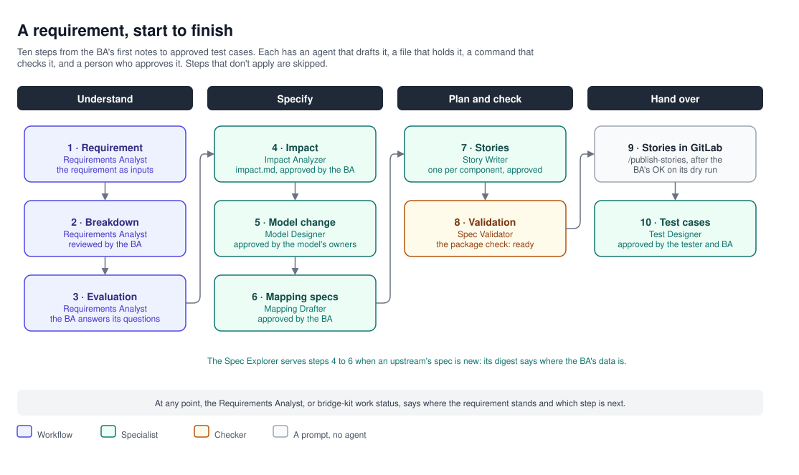

# BRIDGE design: a requirement, start to finish

A requirement moves through ten steps, from the BA's first notes to approved test cases. Each step has an agent that
drafts it, a file that holds it, a command that checks it, and a person who approves it. This document follows
`REQ-101` through them.

## The work item

Everything about a requirement lives in one folder, named by the requirement's key in GitLab:

```text
work/REQ-101/
  inputs/                          what the BA brought: the requirement, stories, wiki pages, documents, spec digests
    01-story-req-101.md
    02-contact-preferences.md
    spec-digest-upstream-1.md
    mapping-request.md
  breakdown.md                     the requirement in parts
  evaluation-01.md                 gaps and questions, one file per round
  decisions.md                     each answer: what was decided, by whom, and why
  impact.md                        the components it touches
  model-change.md                  the shared model's merge request description
  stories/                         one story per affected component
  validation-01.md                 the package read as a developer would
  tests/                           the test cases
```

- **Inputs never change.** Each is kept with its source, its version (a story's last update, a page's or a file's
  hash) and when it was read, and the original sits in the git-ignored `.work/sources/`. A newer version of a story
  or a document becomes a new input beside the old one.
- **Decisions are recorded, never assumed.** An agent writes a decision only when the BA gives it, with who decided.
- **Mapping specs live outside the work item,** in `mappings/`, because they describe the system, not one
  requirement; the shared model's change lives in the model's repo.

## The ten steps



| # | Step | Agent and prompt | Writes | Checked by | Approved by |
|---|---|---|---|---|---|
| 1 | Requirement | Requirements Analyst, `/requirement` | `inputs/` | — | — |
| 2 | Breakdown | Requirements Analyst | `breakdown.md` | — | The BA reviews it |
| 3 | Evaluation | Requirements Analyst | `evaluation-NN.md`, `decisions.md` | — | The BA answers until no question blocks |
| 4 | Impact | Impact Analyzer, `/impact` | `impact.md` | `validate impact` | The BA |
| 5 | Model change | Model Designer, `/model-change` | The model's checkout, `model-change.md` | `validate model` | The model's owners, by merge request |
| 6 | Mapping specs | Mapping Drafter, `/draft-mapping` | `mappings/<upstream>/<operation>.md` | `validate request`, `validate mapping` | The BA |
| 7 | Stories | Story Writer, `/write-stories` | `stories/` | `validate story` | The BA |
| 8 | Validation | Spec Validator, `/validate` | `validation-NN.md` | `validate package` | The BA, on a ready verdict |
| 9 | Published | `/publish-stories` | GitLab issues | `stories publish`'s dry run | The BA, in the chat |
| 10 | Test cases | Test Designer, `/write-tests` | `tests/` | `validate test-case`, `tests coverage` | The tester and the BA |

The Spec Explorer serves steps 4 to 6 whenever an upstream's spec is new: `/explore-spec` writes a digest of where
the BA's data is in it, which the Model Designer and the Mapping Drafter work from.

Steps that don't apply are skipped: with no model change in `impact.md`, step 5 isn't needed; with no new mapping, step
6 isn't. Once `impact.md` exists, the breakdown and the evaluation are behind it.

## Where it stands

`bridge-kit work status REQ-101` works out each step's state from the files alone: done, to do, with problems, or
not needed, and the next step with the prompt that takes it. It runs only the file checks (`validate impact`,
`validate story`, `validate test-case`, `tests coverage`); the model's build and the package check are the Spec
Validator's. The Requirements Analyst starts from it, and a BA can run it any time. The Analyst never moves past a
step with problems: the step's agent fixes it, or the BA does.

## Approval

A file is approved when the BA sets its `status` to `approved`, once they've reviewed it. The checks refuse an
approved mapping spec, story or test case that still has open questions, and the package check refuses a package with
anything left open. A story becomes `created` once it's in GitLab, and carries its GitLab id from then on.

## The package check

Before the developers see it, `bridge-kit validate package REQ-101` checks the package as a whole:

- every file passes its own check;
- everything is approved and nothing is left open, and a file not yet committed is warned about;
- one story for each component `impact.md` names, and none for any other;
- every file a story cites is implemented by a story, and every package file is cited;
- one model version, and contract changes that agree across `impact.md`, the model change and the stories;
- every path the model change adds is filled by a mapping row or an assembly row;
- the mapping requests and the digests agree with the mapping specs, and every cell of the BA's rough mapping that a
  spec cites is still there.

The Spec Validator runs it, then reads every story with the files it implements as that component's developer would,
and reports what they would have to come back and ask: a rule two developers would code differently, two files that
disagree, behaviour no file gives. A finding blocks when the developer can't build it right without the answer.

## The hand-over

- **Stories** go to GitLab with `/publish-stories REQ-101`: each in its component's project (the catalog's
  `stories.project`), with its labels, linked to the requirement's issue and to the stories it waits for. The command
  shows a dry run first and creates nothing until the BA says so in the chat; a story already created is never
  created again.
- **The shared model's change** goes to its owners as a merge request, with `model-change.md` as its description: the
  BA commits the Model Designer's change to a branch of the model's repo, pushes it and opens the merge request.
- **Test cases** stay in the work item, approved by the tester and the BA, for the tester to run and automate.

For `REQ-101`, five stories go out, in the catalog's order: `shared-model` first (the new field), then
`service-a-java` (the mapping), `service-c-java`, `service-d-java` (the API, flagged for its external clients), and
`ui-react` (the panel), each blocked by the one its contract comes from.
