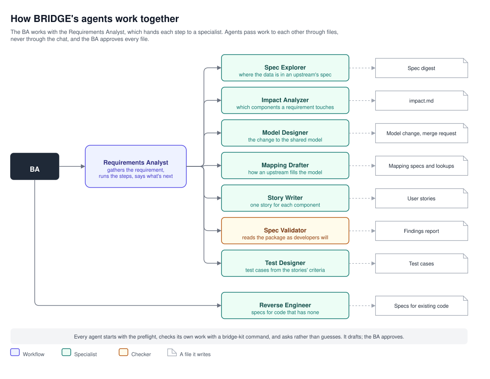

# BRIDGE design: the agents

Nine agents do the BA's work with them, each with one job. The BA talks to the Requirements Analyst, which runs the
steps and names the specialist each one needs; the BA can also start any specialist directly, such as the Spec
Explorer before a requirement even exists.

## How they work together

| Layer | Agents | Does |
|---|---|---|
| Workflow | Requirements Analyst | Gathers the requirement, tracks the steps, hands off to the next specialist |
| Specialist | Spec Explorer, Impact Analyzer, Model Designer, Mapping Drafter, Story Writer, Test Designer, Reverse Engineer | Drafts one kind of file |
| Checker | Spec Validator | Reads the package as the developers would, and reports; fixes nothing |

Agents pass work to each other through files, never through the chat: the Story Writer reads `impact.md`, not the
Impact Analyzer's reply. In VS Code, the Requirements Analyst offers the next specialist as a button.

## Rules every agent follows

1. **The preflight first.** `bridge-kit preflight` checks every checkout the agent may read. If it stops, the agent
   stops and says why.
2. **Only its own files.** Each agent writes only the paths its manifest lists, and never another agent's or another
   repo's, except the Model Designer in the shared model.
3. **Drafts, never approves.** What it writes is a `draft`. What it can't settle goes under Open questions, naming
   who answers.
4. **Ask, don't guess.** A business word it can't place in the glossary or the model, a source the spec doesn't have,
   a rule the request doesn't give: each is a question.
5. **Checks its own work** with its `bridge-kit` command before it finishes, and reports the result.
6. **One command at a time.** Each command runs on its own, never in a loop, a pipe or a chain, so Copilot's tool
   approval matches it by how it starts.
7. **Made-up data only.** It describes fields and behaviour, never values from real records.
8. **Says what it read.** Its reply ends with the checkouts the preflight confirmed and their commits.

## The agents

| Agent | Started with | Reads | Writes | Checks with |
|---|---|---|---|---|
| Requirements Analyst | `/requirement <id> [what you want]` | The work item; a GitLab story or documents; the glossary, model and profiles, to place a term | `inputs/`, `breakdown.md`, `evaluation-NN.md`, `decisions.md` | `work status` |
| Spec Explorer | `/explore-spec <spec> <what you need>` | The spec, through the spec resolver | `inputs/spec-digest-<upstream>.md`, or `work/explore/` with no work item | `validate digest` |
| Impact Analyzer | `/impact <id>` | The requirement and what the work item has (a model change, mapping requests, digests); the catalog, every profile and each component's own knowledge, the model; the checkouts, read-only | `impact.md` | `validate impact` |
| Model Designer | `/model-change <id> <what the model needs>` | The model's checkout and `CONVENTIONS.md`; the digest; payloads by request id, for shape | The model's schemas, examples and versions, in its checkout; `model-change.md` | `model start`, `model diff`, `validate model` |
| Mapping Drafter | `/draft-mapping <id> [<upstream> <operation>]` | The mapping request; the target's schemas; the digest; `FORMAT.md`; the BA's rough mapping | `mappings/`, `lookups/`, the assembly row; `decisions.md` on a second turn | `validate request`, `validate mapping` |
| Story Writer | `/write-stories <id>` | `impact.md` and every file it cites; the catalog, each affected profile, and its team's own prompts and agents, which its story names | `stories/<component>-<nn>-<slug>.md` | `validate story` |
| Spec Validator | `/validate <id>` | The whole package, the story template, `FORMAT.md` | `validation-NN.md` | `validate package` |
| Test Designer | `/write-tests <id>` | The approved stories; `impact.md`'s data elements; the mapping and assembly specs; the model change | `tests/tc-<nn>-<slug>.md` | `validate test-case`, `tests coverage` |
| Reverse Engineer | `/reverse-engineer <component> <path>` | Existing code, read-only; each upstream's spec; the model; `FORMAT.md` | Mapping specs, lookups and assembly rows marked `reverse-engineered`; notes in `work/reverse/<component>/` | `validate mapping` |

What each never does:

- **The Requirements Analyst** doesn't do a specialist's work, and never moves past a step with problems.
- **The Spec Explorer** reads a spec only through the spec resolver, never runs anything from a downloaded jar, and
  never stretches a field that only looks similar: a near match is named and rejected.
- **The Impact Analyzer** never leaves a component out without saying why: every component in the catalog is either
  affected, with its evidence, or not, with its reason.
- **The Model Designer** reuses before it adds, models only what was asked, uses the model's own names and codes, and
  never pushes or opens the merge request.
- **The Mapping Drafter** drafts from what the BA gives, never from code, and leaves every business choice as a
  `proposed` row with a question.
- **The Story Writer** writes exactly one story per affected component in `impact.md`, and carries every open
  question over.
- **The Spec Validator** fixes nothing: every finding goes to whoever owns the file.
- **The Test Designer** uses made-up data only, and reads payloads for their shape.
- **The Reverse Engineer** writes what the code does, never what it should have done, and changes nothing in the
  repo it reads.

## The standalone prompts

Any Copilot chat runs these, each with its skill; none has an agent of its own.

| Prompt | Does |
|---|---|
| `/read-story <story> [work item]` | Reads a GitLab story with its comments and links, and keeps it as an input |
| `/read-wiki <what to find, or a page> [work item]` | Answers from the GitLab wiki, and keeps the pages it relied on |
| `/read-document <file> [work item]` | Reads a spreadsheet, a Word or PDF document, slides, a saved page, an email or an image |
| `/read-payload <request id> [service]` | Reads a stored payload and checks it against the shared model |
| `/publish-stories <id>` | Creates a work item's approved stories in GitLab, after the BA's OK on its dry run |
| `/profile-component <folder> <name>` | Writes one component's profile for the catalog |
| `/profile-model [<checkout>]` | Proposes the model's layout and conventions, and drafts its `CONVENTIONS.md` |
| `/draft-glossary <area>` | Drafts a business area's terms |

## How an agent is made

Each agent is four kinds of file, joined by its name:

| File | Holds | Read by |
|---|---|---|
| `.github/agents/<name>.agent.md` | Its description, tools and handoffs, then its instructions: what it's given, what it writes and where, how it works, its rules | Copilot |
| `.github/prompts/<prompt>.prompt.md` | The prompt that starts it, asking for its arguments | Copilot |
| `.github/skills/<skill>/SKILL.md` | The know-how it loads for one kind of work, such as `mapping-format` or `story-writing`, shared by every agent that needs it | Copilot |
| `.github/bridge-kit/agents/<name>/manifest.yaml` | Its version and status, owner, layer, inputs and outputs, the paths it may write, and the skills it needs, by version | `bridge-kit` |

The skills are the shared knowledge: `requirement-analysis`, `impact-analysis`, `spec-exploring`, `spec-resolver`,
`model-designing`, `mapping-drafting`, `mapping-format`, `story-writing`, `package-review`, `test-designing`,
`reverse-engineering`, `glossary-drafting`, and the readers and writers `gitlab-reading`, `gitlab-writing`,
`document-reading` and `payload-reading`. An agent's instructions say what it does; its skills say how.

Every agent file is checked against the fields Copilot reads, every manifest against its schema, its agent and its
skills, every skill against the Agent Skills format, and every `bridge-kit` command an agent, prompt or skill names
must exist.
